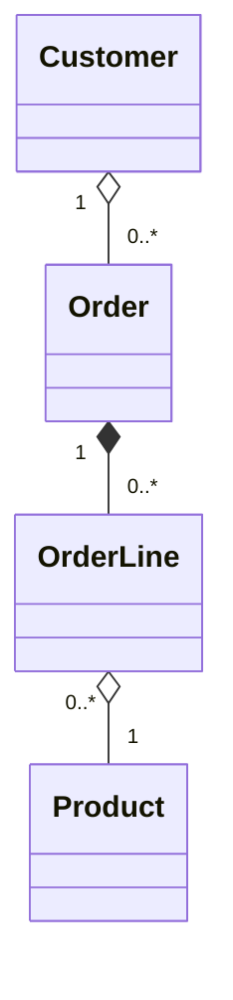

# Customer Order Class diagram

Order lines cannot exist without an Order. 
An order can have any number of order lines. 
It is not obvious whether having 0 order lines should be allowed. 
I think it may be preferable to allow it and be ready to handle such cases separately. 

Every order line needs one product. 
The products exist independent of the order lines.
Multiple order lines can have the same product, but no order line needs to have one product. 

I believe the relationship between customer and order could look several different ways. 
Each order should always have exactly one customer. 
We could allow for a customer to make multiple orders (for example if they have an account), 
or we could treat the customer of each order as unique (even if they are associated with the same real person). 
Either way, it is not necessarily clear if it should be composition or aggregation. 
In the case of one customer per order it is not even clear in what direction the relationship will be. 
I will make the assumption that one customer can have multiple orders, but that those orders exist independent of the customer. 

