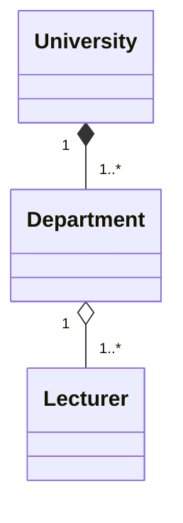

# University departments Class diagram

University owns departments, departments cannot exist independently of the university

Departments has lecturers, they can exist independently

Is there any (direct) relationship between University and Lecturer? Seems like no

I make the assumption that each University has at least one Department, and each Department has at least one Lecturer

